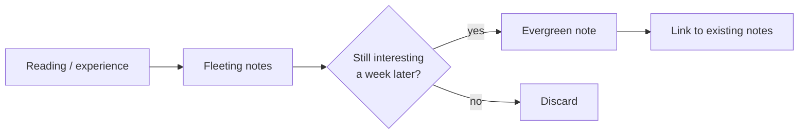

Evergreen notes are written to be developed and reused over time, across projects. The term comes from Andy Matuschak, who describes a few principles for them.

## The principles

### Atomic
Each note covers one idea, and covers it completely. If a note is about two things, split it. Atomic notes are easier to link to because a link points at a precise idea instead of a vague neighbourhood.

### Concept-oriented
Organize notes by **concept**, not by source or project. A note called "Notes on *Thinking, Fast and Slow*" is a dead end. A note called "Intuition is fast but overconfident" can be linked from ten different places.

### Densely linked
The value is in the connections. When writing a note, ask: *what does this remind me of?* Then link it. This garden tries to do the same, for example by connecting [[ideas/Gall's law]] to [[tech/Deep modules]].

### Titles as claims
A good title states the idea instead of naming the topic:

> [!example] Weak title vs. strong title
> - ❌ "Home automation"
> - ✅ "[[tech/Home automation should be boring|Home automation should be boring]]"

A claim title lets you reference the idea in a sentence without opening the note.

## Notes vs. transient notes

Not everything should become an evergreen note. Meeting notes, to-do lists, and highlights are **transient**. Their job is to feed evergreen notes, then they can be thrown away.

## Related

- [[ideas/Zettelkasten]] is the older, analog version of this idea.
- [[ideas/Digital gardens]] are what happens when you publish your evergreen notes.
