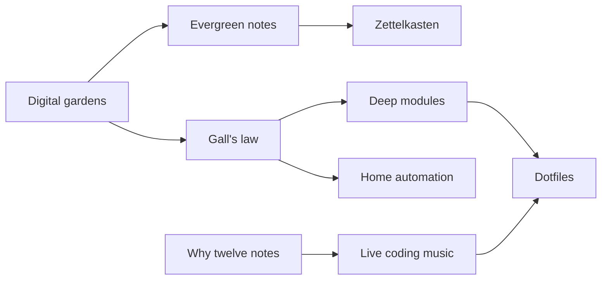

This is a digital garden: a set of linked notes that grow over time. These aren't finished blog posts. Some notes are rough, some are mostly settled, and all of them can be revised.

> [!tip] How to read this place
> Follow the links rather than reading top to bottom. Each note carries a status tag so you know how much weight to give it:
>
> - 🌱 **[[tags/seedling|Seedling]]**: a rough idea, recently planted
> - 🌿 **[[tags/budding|Budding]]**: taking shape, still being revised
> - 🌳 **[[tags/evergreen|Evergreen]]**: fairly settled, revisited now and then

## Where to start

- [[ideas/Digital gardens|What is a digital garden?]] explains why this site isn't a blog.
- [[ideas/Evergreen notes|Evergreen notes]] covers the note-writing practice behind it.
- [[ideas/Gall's law|Gall's law]] is about why working systems start small.

## Sections

### 🧠 Ideas
How to think, write, and build.
- [[ideas/Digital gardens|Digital gardens]]
- [[ideas/Evergreen notes|Evergreen notes]]
- [[ideas/Zettelkasten|Zettelkasten]]
- [[ideas/Gall's law|Gall's law]]

### 🛠️ Tech
Software design and the tools I use every day.
- [[tech/Deep modules|Deep modules]]
- [[tech/Dotfiles are a living document|Dotfiles are a living document]]
- [[tech/Home automation should be boring|Home automation should be boring]]

### 🎵 Music
The math and code behind sound.
- [[music/Why twelve notes|Why twelve notes]]
- [[music/Live coding music|Live coding music]]

## How the notes connect

